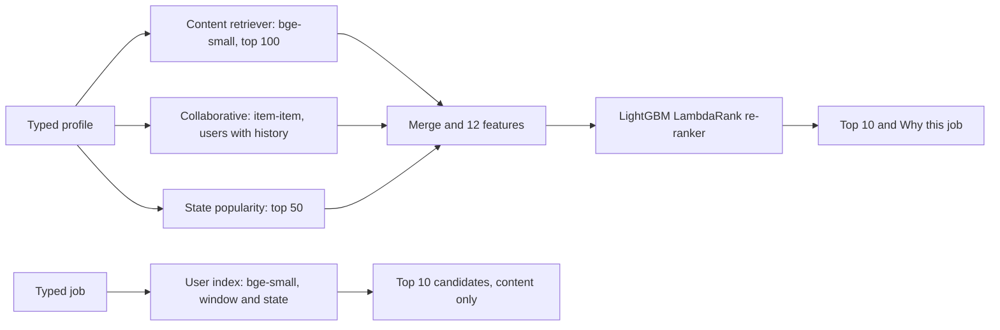

# TalentMatch: Two-Sided Job and Candidate Recommendation Engine

Olo Academy AI Engineering Bootcamp (AIEP), Module 8 capstone, Track C (HR tech, recommendation systems).
Team: Aryam, Layan, Amnia.

## Problem and motivation

Job platforms receive thousands of applications per posting. Keyword filters reject good candidates who describe their experience differently, and job seekers scroll through postings that do not fit. TalentMatch ranks jobs for a candidate and candidates for a job, works on a profile or a job typed in a few seconds with no application history, and shows why each job appears. It ranks and explains; the recruiter decides.

- **Job seeker view:** type degree, major, years, past roles, skills, state and city, and get ten ranked jobs with the matched skills and the sentence that supports each one.
- **Recruiter view:** type a job (or pick one) and get ten ranked candidates by content similarity.

## Architecture



## Data

- **Source:** CareerBuilder Job Recommendation Challenge on Kaggle (users, jobs, applications, work history), as specified in the capstone brief. The brief gives no licence text. Skills vocabulary: ESCO v1.2.1 (`skills_en.csv`).
- **Not in this repository:** raw data, embeddings and large tables. Download the Kaggle files and unzip them under `data/` (scripts expect `data/apps/apps.tsv`; the `clean_*.py` scripts in `src/` write `data/processed/`). The large model-side files are listed in `artifacts/README.md`.
- **Time-based split** (`src/make_split.py`): train up to 2012-06-05 (1,290,087 applications), validation 2012-06-06 to 2012-06-13 (154,298), test 2012-06-18 to 2012-06-26 (153,355). The re-ranker is trained on the last week of the train period (2012-05-30 to 2012-06-05), early-stopped on validation and judged once on test. Decisions frozen before the test run are in `docs/frozen_before_test.md`.

## Install

```
python -m venv .venv
.venv\Scripts\activate          # macOS/Linux: source .venv/bin/activate
pip install -r requirements.txt
```

Developed with Python 3.14 and LightGBM 4.7.0 on Windows; no GPU needed.

## Quick checks (no data needed)

```
python -m pytest tests -q
```

This runs the smoke tests, including loading `artifacts/reranker_v2` (checksum, load, ranking of cold-start rows).

## Run the demo

Needs the large files from `artifacts/README.md` and `python src/build_jobs_text.py` once.

```
python -m streamlit run app/app.py
```

Rank jobs for a new profile from the command line, loading the artifact in a fresh process:

```
python src/profile_recommender.py --state CA --degree "Bachelor's" --major "Business Administration" --years 5 --roles "Sales Associate"
```

## Reproduce the main results

```
# training period (2012-05-30 to 2012-06-05)
python src/gen_candidates.py --name train_rr --start 2012-05-30 --end 2012-06-06 --history_before 2012-05-30 --open_from 2012-05-30 --k 100
python src/gen_pop_candidates.py --users_from results/recs/train_rr_content.csv --open_from 2012-05-30 --end 2012-06-06 --history_before 2012-05-30 --k 50 --out results/recs/train_rr_pop.csv
python src/build_features.py --content results/recs/train_rr_content.csv --collab results/recs/train_rr_collab.csv --pop results/recs/train_rr_pop.csv --labels results/recs/train_rr_labels.csv --pop-before 2012-05-30 --period-start 2012-05-30 --out data/processed/features_train_rr3.parquet

# validation (2012-06-06 to 2012-06-13)
python src/gen_candidates.py --name val_check --start 2012-06-06 --end 2012-06-14 --history_before 2012-06-06 --open_from 2012-06-06 --k 100 --eval_split val
python src/gen_pop_candidates.py --users_from results/recs/val_check_content.csv --open_from 2012-06-06 --end 2012-06-14 --history_before 2012-06-06 --k 50 --out results/recs/val_pop.csv
python src/build_features.py --content results/recs/val_check_content.csv --collab results/recs/val_check_collab.csv --pop results/recs/val_pop.csv --labels results/recs/val_check_labels.csv --pop-before 2012-06-06 --period-start 2012-06-06 --out data/processed/features_val3.parquet

# train, then evaluate on validation
python src/train_reranker_v2.py --train data/processed/features_train_rr3.parquet --val data/processed/features_val3.parquet
python src/evaluate.py --recs results/recs/rerank_v2.csv --split val --name rerank_v2

# test (open jobs from