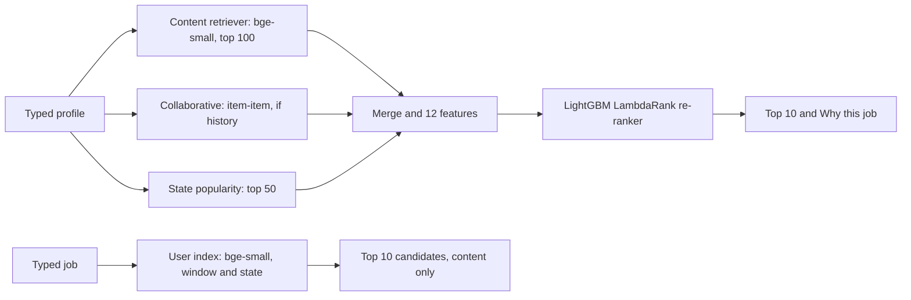
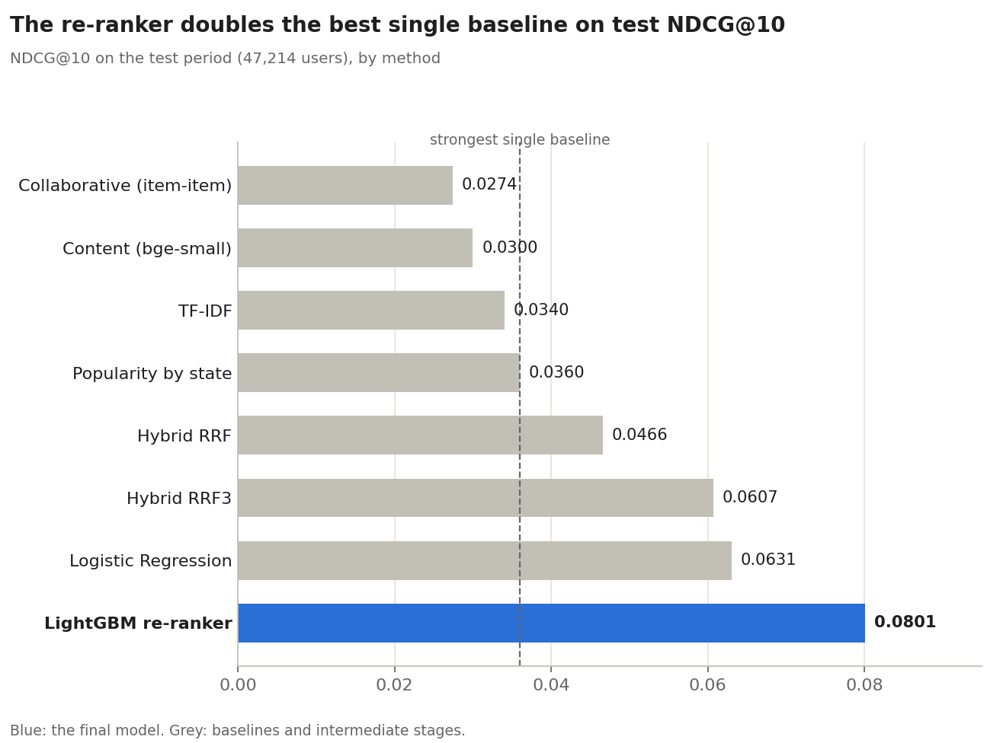
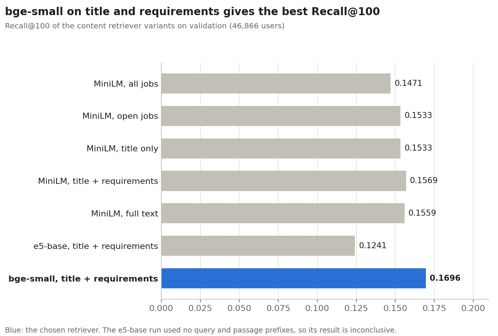
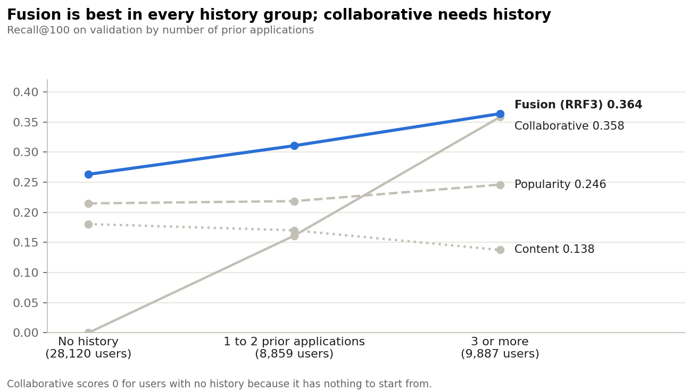
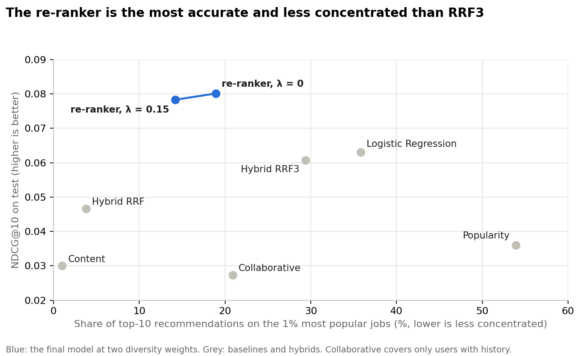
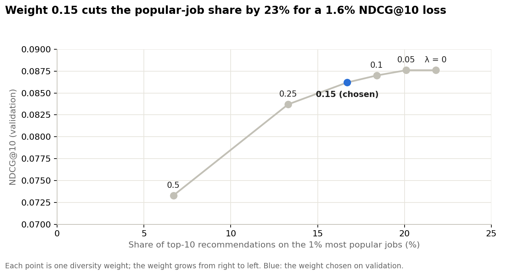

# Capstone Project Report

**Project Title:** TalentMatch: A Two-Sided Job and Candidate Recommendation Engine

**Student Name:** Aryam Almohammadi, Layan Almohammadi, Omnia Alsadi

**Cohort:** Olo Academy AI Engineering Bootcamp (AIEP), Module 8 capstone, Track C

**Date:** 31 Oct 2026

**Repository URL:** https://github.com/aryam-mis/Capstone_TalentMatch

---

## 1. The Problem

### 1.1 Problem Definition

TalentMatch ranks jobs for a candidate and candidates for a job, and it works on a profile or a job posting typed in seconds, with no application history. For a job seeker it returns ten ranked jobs with the skills the profile and each job share; for a recruiter it returns ten ranked candidates.

### 1.2 Intended Users and Decisions

- **Job seeker:** types a short profile (degree, major, years of experience, past roles, state, optional city and skills) and gets ten ranked jobs, either from the re-ranker (default) or from Profile match, a cold-start mode that ranks by similarity to the profile and skills. Each job shows the matched skills, the most similar past role and whether it is in the same city, with the sentence that supports each skill.
- **Recruiter:** types or picks a job and gets ten ranked candidates by content similarity, each with their past roles, the job skills found in their major or past roles, and their past role most similar to the job title. The re-ranker is not applied in this direction. The system ranks and never rejects, so the recruiter stays in control.
- **Platform team:** needs to know whether the recommendations are accurate, diverse and not dominated by a few popular jobs.

### 1.3 Why This Problem Matters

Job platforms receive thousands of applications per posting. Keyword filters reject good candidates who describe their experience differently, and job seekers scroll through postings that do not fit. The system narrows both lists and shows why each item appears, so a recruiter or a candidate can check the reason instead of trusting a score.

### 1.4 Success Criteria

- Ranking quality on a period the models never saw: P@10, NDCG@10 and MAP@10 above every baseline, with the gain of each stage measured (experiment E1).
- A candidate pool that does not hide relevant jobs: Recall@50 and Recall@100.
- Beyond accuracy: catalogue coverage and the share of recommendations that go to the top 1% most popular jobs (experiment E5).
- Latency under 2 seconds per request.
- Modelling decisions frozen before the test run (`docs/frozen_before_test.md`), so the test result is not tuned.

**Headline result.** On the test period the re-ranker reaches NDCG@10 0.0801, against 0.0360 for the strongest single baseline (popularity by state), about 2.2 times higher. The evaluation is offline and uses implicit feedback: an application is a positive, and a job the user did not apply to is not necessarily a job the user disliked.

---

## 2. The Data

### 2.1 Data Source and License

**Dataset Name:** CareerBuilder Job Recommendation Challenge data (users, jobs, applications and work history)

**Source:** https://www.kaggle.com/c/job-recommendation

**License:** The capstone brief gives no licence text. The raw data is not redistributed in the repository.

**Date Accessed:** not recorded; the files were obtained through the team's shared folder.

The data matches the task: it contains real applications, user profiles and job texts, organised in time windows, so a time-based evaluation is possible. Restrictions: the raw and processed files stay outside the repository, and the team can provide them on request.

### 2.2 Data Collection and Reproducibility

The files come from the Kaggle competition page (a Kaggle account is needed) or from the team's shared folder. To prepare them, run the cleaning scripts in `src/` (`clean_*.py` and the job-text preparation), then `src/make_split.py` for the time-based split, `src/prepare_union.py` and the embedding notebook script `notebooks/colab_generate_embeddings.py` for the job embeddings. The README lists the commands in order.
 **Job-Text Cleaning and Preparation**

The job data was processed in batches of 5,000 records using `src/clean_jobs.py`. HTML tags, escaped line breaks, and unnecessary whitespace were removed from job titles, descriptions, and requirements.

Next, `src/prepare_job_text.py` combined these cleaned fields into a unified `text_clean` column while preserving the original job information. This prepared the textual data for further processing and experimentation.

### 2.3 Dataset Card

- **Purpose and intended use:** predicting which jobs a user applies to from earlier applications, demographics and work history.
- **Composition:** four tables keyed by the window as well as the id (see 2.4), covering 1,603,111 applications from 2012-04-01 to 2012-06-26.
- **Collection process:** the platform's own logs, in seven windows that are separate samples.
- **Intended users:** researchers and teams that build recommenders.
- **Out-of-scope uses:** conclusions about today's job market or about the Saudi market, and any decision about a person without a human in the loop.
- **Biases and limitations:** applications reflect what users were shown, so popular and well-placed jobs get more of them; city and missing profile fields can act as proxies.
- **Privacy:** users are numeric ids. We added no personal information, and the repository holds no raw data or embeddings.

### 2.4 Dataset Structure

**Unit of observation:** one application (a user applied to a job on a date); a job is identified by (JobID, WindowID).

| Table | Columns | Fields we use |
| --- | --- | --- |
| Users | 15 | UserID, WindowID, Split, City, State, Country, ZipCode, DegreeType, Major, GraduationDate, WorkHistoryCount, TotalYearsExperience, CurrentlyEmployed, ManagedOthers, ManagedHowMany |
| Jobs | 11 (+ text_clean) | JobID, WindowID, Title, Description, Requirements, City, State, Country, Zip5, StartDate, EndDate, plus `text_clean`, our cleaned job text |
| Applications | 4 | UserID, WindowID, ApplicationDate, JobID |
| User history | 5 | UserID, WindowID, Split, Sequence, JobTitle |

### 2.5 Target Variable and Distribution

A recommender has no label column: the relevant jobs of a user in a period are the jobs the user applied to in that period. After the candidate pools are built, the test feature table has 7,507,456 user-job pairs for 47,098 users and only 48,117 positives (0.64%), so the problem is extremely sparse, and Recall@100 is limited by the candidate pool.

**Time-based split** (applications by date; the original `Split` column is ignored):

| Period | Applications on | Rows | Users |
| --- | --- | --- | --- |
| Train | up to 2012-06-05 | 1,290,087 | 263,824 |
| Validation | 2012-06-06 to 2012-06-13 | 154,298 | 46,866 |
| Test | 2012-06-18 to 2012-06-26 | 153,355 | 47,214 |

There are no applications from 2012-06-14 to 2012-06-17. The re-ranker is trained on the last seven days of the train period (2012-05-30 to 2012-06-05: 88,647 applications, 28,164 users), early-stopped on validation and judged once on test.

| Feature table | Rows | Users | Positives |
| --- | --- | --- | --- |
| Training period | 4,592,389 | 28,120 | 30,174 |
| Validation | 7,495,625 | 46,754 | 51,981 |
| Test | 7,507,456 | 47,098 | 48,117 |

### 2.6 Data Quality Issues

- **Corrupt dates:** 5,371 of the 1,603,111 application rows (0.33%) had corrupt dates and were removed, leaving 1,597,740 (the sum of the three splits).
- **Missing job dates:** some jobs have no StartDate or EndDate. The open-jobs filter treats a missing date as open.
- **Missing user fields:** some users have no state or window information (57 in validation), and some have no degree or major. Their similarity rests on past roles alone.
- **Windows:** the seven windows are separate samples, so the same JobID in two windows is two different jobs. Every job key is (JobID, WindowID).
- **Cold start:** users with history before the period are 45.7% in the training period (12,875 of 28,164), 40.0% in validation and 38.8% in test (18,303 of 47,214). The collaborative history in the training period is shorter (2012-04-01 to 2012-05-29), so its signal looks different from validation and test. This is a limitation of the training setup.

---

## 3. Exploration

### 3.1 Exploration Objective

To find what a recommender must handle: users and jobs with no history, and a market where a few jobs attract most applications.

### 3.2 Key Finding 1: most users are cold

60% of validation users (28,120 of 46,866) have no earlier application, and 61.2% of test users have none. Collaborative filtering gives nothing for them (Recall@100 of 0 in experiment E3), so content and popularity must carry the cold start.

### 3.3 Key Finding 2: many targets are new jobs

26.6% of validation targets are jobs that no one applied to in the training period. Only the content retriever can find them: its Recall@100 is 0.1858 on these targets, against 0.1307 for the fusion with collaborative filtering and popularity (difference 0.0551, 95% interval 0.0527 to 0.0579, from a user-level bootstrap of 2,000 resamples).

### 3.4 Additional Finding: popularity is concentrated

On test, recommending the most popular open jobs of the state puts 53.9% of the top-10 slots on the 1% most popular jobs and covers only 1.08% of the 228,062 open jobs. Any popularity signal in the model therefore has a cost in diversity, which experiment E5 measures.

---

## 4. Method: What We Built and What We Rejected

### 4.1 End-to-End Pipeline

Three candidate sources feed one LightGBM re-ranker, and the recruiter view is a separate content-only search.



The re-ranker sees content, collaborative and popularity signals for each user-job pair. A new user has no collaborative signal, so those two features stay empty. The Why column shows the ESCO skills the profile and the job share, the past role most similar to the job title, and the location match. For new users the app also offers Profile match, which ranks the content candidates by cosine to the profile plus the typed skills and pushes titles such as Senior, Lead or Manager down for users with under 3 years of experience; the frozen re-ranker is unchanged.

### 4.2 Preprocessing and Feature Engineering

- **Text:** jobs are embedded as "title. requirements"; users as "degree: ... major: ... experience: N years. past roles: ...". Embeddings come from `BAAI/bge-small-en-v1.5`, used frozen and normalised.
- **Text Preparation:** The preprocessing pipeline created a combined `text_clean` field using job titles, descriptions, and requirements. However, the final content-based embedding approach used job titles and requirements, as this combination performed better than using the full job text in the team's experiments.
- **Candidates:** for each user, the union of the top 100 jobs by content cosine, the top 100 by item-item collaborative filtering (users with history only) and the 50 most popular open jobs of the state, all inside the user's window and state.
- **12 features per user-job pair:** `content_score`, `content_rank`, `collab_score`, `collab_rank`, `pop_rank`, `same_city`, `job_pop`, `job_age_days`, `days_left`, `user_n_hist`, `TotalYearsExperience`, `WorkHistoryCount`. `same_state` is left out because every candidate is already in the user's state.
-    Job text is lower-cased, built from the title and the first 600 characters of the requirements, and encoded with a maximum sequence length of 128, normalised, in fp16 on a Colab T4, for the 444,522 jobs open in at least one period. The row order of the embeddings was checked against the job table (`src/verify_embeddings.py`).

### 4.3 Model Selection

LightGBM LambdaRank, one group per user, applications as positives and the other candidates as negatives. It uses at most 500 trees, learning rate 0.05, 31 leaves and at least 50 samples per leaf. Training uses the 13,412 training-period users with at least one positive (2,279,552 rows), early stopping on validation NDCG@10 stopped at iteration 116, and the seed is 42. A tree model fits because the collaborative features are empty for new users and because popularity, city and similarity interact.

### 4.4 Baseline and Alternative Approaches

All use the same open-jobs filter and skip jobs the user already applied to.

- **Popularity by state:** the most applied-to open jobs in the user's state and window, counted before the period.
- **TF-IDF:** vectoriser fitted on previously applied jobs, cosine against the open jobs of the user's window and state.
- **Content embeddings:** bge-small on title plus requirements, cosine inside each window and state.
- **Collaborative filtering:** item-item cosine on the user-job matrix with popularity normalisation, built from applications before the period.
- **Hybrid:** reciprocal rank fusion (k = 60) of content and collaborative (RRF), and with popularity added (RRF3).
- **Logistic Regression:** same candidates and features as the re-ranker, with median imputation plus missing-value indicators, standardisation, balanced class weights and C = 1, fitted on the training period only and not tuned on validation.

### 4.5 Data Leakage Prevention

- The split is by time, so no model learns from applications made after the period it is judged on.
- Job popularity and a user's history count use only applications made before the start of the period being scored.
- Candidates exclude jobs the user already applied to before the period, and the evaluation removes the same jobs from the ground truth.
- Every method, baselines included, recommends only jobs that are open in the period (EndDate empty or on/after the start, StartDate empty or before the end). For test the filter is EndDate on/after 2012-06-18 and StartDate before 2012-06-27.
- The TF-IDF vocabulary is fitted on jobs applied to before the cutoff, and the embedding model is used frozen.
- The model, features, diversity weight, candidate sizes and filter were frozen in `docs/frozen_before_test.md` before anything ran on test.

### 4.6 Implementation Challenges and Failed Attempts

- **The first re-ranker lacked popularity as a candidate source.** Its validation Recall@100 was 0.2511, below the 0.2934 of the RRF3 hybrid, because a popular job that neither retriever found could never be shown. Adding the 50 most popular open jobs of the state as a third source (feature `pop_rank`) raised it to 0.3195. The final model is this second version (`reranker_v2`).
- **Random negatives trained a worse ranker** than hard negatives (experiment E4).
- **The e5-base embedding run was inconclusive**: it ran without its query and passage prefixes, so we cannot tell whether the model or the setup caused its low score (experiment E2).

#### Experimental Cold-Start Ranking Improvements (Not Integrated)

A separate experiment explored improving recommendations for users without previous application history. The approach combined semantic similarity with experience requirements, job seniority, and city matching.

An updated experience extraction process increased detection coverage from 16.1% to 46.5% across 1,092,096 job records.

A caching optimization reduced observed initialization time from 76.8 seconds to 18.4 seconds in local testing.

However, higher extraction coverage does not necessarily indicate higher accuracy. The updated recommendation approach requires further evaluation and was not integrated into the final LightGBM ranking pipeline. It is separate from the Profile match mode of the app (Section 5.6), which is integrated and uses only the content candidates, the typed skills and a senior-title penalty.

## 5. Results

### 5.1 Evaluation Setup

Metrics are P@10, NDCG@10, MAP@10, Recall@50 and Recall@100, averaged over all users of the period (47,214 users on test). The model, features, candidate sizes, open-jobs filter and diversity weight were frozen before the first test run, and the re-ranker was run once on test, so the number is not tuned.

### 5.2 Baseline Performance

The strongest single baseline on test is popularity by state: NDCG@10 0.0360, P@10 0.0177, Recall@100 0.2196. TF-IDF (0.0340) beats the bge-small content retriever (0.0300), which suggests that exact words help when the user text is short. The collaborative retriever recommends only for the 14,631 test users with history.

### 5.3 Final Model Performance

| Split | Diversity weight | P@10 | NDCG@10 | MAP@10 | Recall@50 | Recall@100 |
| --- | --- | --- | --- | --- | --- | --- |
| Validation | 0 | 0.0346 | 0.0876 | 0.0568 | 0.2551 | 0.3195 |
| Test | 0 | 0.0304 | 0.0801 | 0.0513 | 0.2425 | 0.3060 |
| Test | 0.15 | 0.0291 | 0.0783 | 0.0502 | 0.2409 | 0.3046 |

The re-ranker's test NDCG@10 is 8.6% below its validation value. Validation chose the stopping point, so its number is optimistic, and the retrievers also dropped about 3.5% between the periods (content NDCG@10 0.0311 to 0.0300), so part of the gap is the period itself. We cannot separate the two causes.

To check that the differences are real, we resampled the 47,214 test users 2,000 times (paired bootstrap, seed 42, `src/bootstrap_test_ci.py`):

| Comparison (NDCG@10) | Difference | 95% interval | Relative |
| --- | --- | --- | --- |
| re-ranker minus RRF3 | +0.0195 | 0.0181 to 0.0207 | +32% |
| re-ranker minus Logistic Regression | +0.0171 | 0.0159 to 0.0183 | +27% |
| re-ranker minus popularity | +0.0441 | 0.0424 to 0.0458 | +123% |
| diversity weight 0 minus 0.15 | +0.0018 | 0.0014 to 0.0023 | +2.4% |

None of these intervals comes close to zero. They cover only the choice of test users: each method is one trained model, so the randomness of training (seeds) is not covered.

### 5.4 Results Comparison

#### E1. What does each stage add?



The re-ranker is 2.2 times the strongest single baseline, 32% above the best hybrid (RRF3, which draws on the same three candidate sources) and 27% above a Logistic Regression on the same features.

| Method | P@10 | MAP@10 | Recall@50 | Recall@100 |
| --- | --- | --- | --- | --- |
| Collaborative (item-item) | 0.0108 | 0.0174 | 0.0875 | 0.1035 |
| Content (bge-small) | 0.0095 | 0.0196 | 0.1167 | 0.1661 |
| TF-IDF | 0.0109 | 0.0218 | 0.1331 | 0.1864 |
| Popularity by state | 0.0177 | 0.0211 | 0.1488 | 0.2196 |
| Hybrid RRF | 0.0157 | 0.0302 | 0.1702 | 0.2309 |
| Hybrid RRF3 | 0.0246 | 0.0372 | 0.2097 | 0.2844 |
| Logistic Regression | 0.0262 | 0.0391 | 0.2236 | 0.2999 |
| LightGBM re-ranker | 0.0304 | 0.0513 | 0.2425 | 0.3060 |

Recall@100 is capped by the candidate pool. The re-ranker's pool holds 50 popular jobs per user while RRF3 uses 100, so the comparison slightly favours the hybrid, and the re-ranker is still ahead.

#### E1b. How much weight should popularity get in the fusion?

We swept the weight of the popularity source in the reciprocal rank fusion (0, 0.1, 0.3, 0.5 and 1.0) on validation, for the fusion of content, collaborative and popularity and for content with popularity only (figure below). Recall@100 stays almost flat up to a weight of 0.3 and rises sharply from 0.5. For the three-source fusion, going from weight 0 to weight 1 raises Recall@100 from 0.2361 to 0.2934 for all users and from 0.1806 to 0.2632 for users without history. The same weight lowers Recall@100 on new jobs (jobs nobody applied to before the period) from about 0.18 to 0.1307, because popularity can only rank jobs that already have applications. So popularity helps the average user and the cold start, and hurts new jobs. The best value in the sweep is the largest tested weight (1.0), so the true optimum may lie above it; we did not test larger weights. This trade-off is the reason the final system lets the re-ranker learn how to combine the sources instead of using one fixed weight.


#### E2. Which text and which embedding model?



All rows are the content retriever on validation. Restricting the search to open jobs raised Recall@100 from 0.1471 to 0.1533. Adding the requirements to the title (0.1569) beats the title alone (0.1533) and the full text (0.1559), which adds noise. bge-small beats MiniLM by about 0.013 (0.1696 against 0.1569), so the system uses bge-small on title plus requirements. e5-base scored lowest (0.1241), but it was run without its query and passage prefixes, so the cause is unconfirmed and we record it as an inconclusive result, not a verdict on the model.

#### E3. How does it behave by user history?



Validation users are split by prior applications. For users with no history (28,120, 60% of validation users) the collaborative retriever scores 0, and the fusion with popularity (RRF3) is best at 0.2632, ahead of popularity alone (0.2149) and content (0.1806). With 3 or more prior applications (9,887 users) collaborative filtering becomes the strongest single retriever (0.3584) and the fusion still leads (0.3639). Content falls from 0.1806 to 0.1376 as history grows, probably because users with history apply to jobs that match their profile text less; we did not test this. So popularity and content carry the cold start and collaborative filtering carries users with history, which is why the pipeline keeps all three. Jobs behave the same way (Section 3.3).

**E3 on the test period** (`src/e3_cold_start_eval.py`). We repeated the analysis on test for every method, the re-ranker and Profile match included, separately for new users and new jobs.

| NDCG@10 on test | 0 prior (28,911 users) | 1-2 (8,962) | 3+ (9,341) | All |
| --- | --- | --- | --- | --- |
| Collaborative | 0.0000 | 0.0457 | 0.0949 | 0.0274 |
| Content | 0.0313 | 0.0334 | 0.0226 | 0.0300 |
| Profile match | 0.0315 | 0.0335 | 0.0226 | 0.0301 |
| Popularity | 0.0320 | 0.0327 | 0.0514 | 0.0360 |
| TF-IDF | 0.0371 | 0.0334 | 0.0247 | 0.0340 |
| Hybrid RRF3 | 0.0444 | 0.0712 | 0.1012 | 0.0607 |
| Logistic Regression | 0.0466 | 0.0688 | 0.1084 | 0.0631 |
| LightGBM re-ranker | 0.0639 | 0.0881 | 0.1227 | 0.0801 |

| New jobs on test (27.4% of targets, 23,160 users) | Recall@10 | Recall@50 | Recall@100 |
| --- | --- | --- | --- |
| Popularity | 0.0000 | 0.0000 | 0.0000 |
| Collaborative | 0.0000 | 0.0000 | 0.0000 |
| Logistic Regression | 0.0099 | 0.0582 | 0.1225 |
| Hybrid RRF3 | 0.0217 | 0.0796 | 0.1214 |
| LightGBM re-ranker | 0.0316 | 0.0770 | 0.1233 |
| Content / Profile match | 0.0515 | 0.1239 | 0.1754 |
| TF-IDF | 0.0592 | 0.1407 | 0.1962 |

61% of test users had no prior application. The re-ranker remains the best method for them (NDCG@10 0.064, twice popularity and Profile match), and its advantage grows with history (0.123 for 3 or more applications); collaborative filtering gives nothing for new users. For new jobs, popularity and collaborative filtering cannot recommend them at all, and only the content retrievers reach them (TF-IDF Recall@100 0.196, embeddings 0.175), while the re-ranker drops to 0.123 because it favours jobs with many past applications. Offline logs reward popular local jobs because they record what new users applied to, not what fits their skills; this is why the app also offers Profile match and why the human judgement set is needed to judge relevance for cold-start users. Profile match is evaluated here without the typed skills text, which dataset users do not have, so its score is close to the content retriever.

#### E4. Hard or random negatives?

Both models use the same positives and the same features, limited to features that can be computed for any user-job pair (content cosine, same city, job popularity, job age, days left, history count, years of experience, work history count). The collaborative and rank features are left out so that random negatives, which have none, cannot be told apart by their missing values. Both were early-stopped on validation and scored on all validation candidates.

| Negatives | Training rows | P@10 | NDCG@10 | MAP@10 | Recall@100 |
| --- | --- | --- | --- | --- | --- |
| Hard: retriever candidates the user did not apply to | 2,279,552 | 0.0299 | 0.0744 | 0.0471 | 0.3130 |
| Random: open jobs of the user's window and state | 1,103,563 | 0.0245 | 0.0642 | 0.0405 | 0.2860 |

Hard negatives win on every metric, by 16% in NDCG@10, and the direction is the same on the earlier candidate pool without the popularity source (0.0697 against 0.0623). A likely reason is that random jobs are mostly far from the user, so the model learns to separate near from far instead of choosing among similar candidates, which is what serving needs. Two cautions: the hard-negative training set is twice as large, and each number comes from one model.

#### E5. What does reducing popularity bias cost?

We measure the share of top-10 recommendations that go to the 1% most popular open jobs (popularity counted before the period) and the catalogue coverage (distinct recommended jobs divided by open jobs). On test the re-ranker is both the most accurate and less concentrated than the hybrid with popularity and the Logistic Regression: 18.9% of its top-10 goes to the top 1%, against 29.4% for RRF3 and 35.8% for Logistic Regression, with coverage of 21.0% against 17.4% and 10.0%. Popularity alone sends 53.9% there and covers 1.1% of the catalogue. Content and plain RRF are the most diverse (1.0% and 3.8%) but much less accurate.



**Diversity re-scoring.** Inside each user's candidate list the final score subtracts a popularity penalty, so popular jobs lose ground to similar but less popular ones:

adjusted score = z(model score) − λ · z(log(1 + job popularity))



On validation, 0.15 is the largest weight that loses under 2% of NDCG@10 (1.6%), and it lowers the top-1% share from 21.8% to 16.7%. On test the same weight lowers the share from 18.9% to 14.2% and raises coverage from 21.0% to 23.4% for a 2.2% loss in NDCG@10. Adding popularity as a candidate source raised the share at weight 0 from 11.8% (first version, validation) to 21.8%, so accuracy and popularity concentration rise together and the weight is the control that moves them back.

#### Recruiter direction

On validation, ranking the candidates of the same window and state by content similarity (job embedding against user embeddings) reaches Recall@10 0.0850 and Recall@20 0.1249. Random ranking inside the same pool gives 0.0086 and 0.0168, and the "most active users" baseline gives 0.0362 and 0.0596 (46,977 open jobs with at least one real applicant, 3.11 real applicants per job on average, 82.2% of them inside the pool). At 10 candidates the content ranking is about ten times random and 2.3 times the most-active baseline (`src/recruiter_baseline.py`, `src/recruiter_candidates.py`).

#### Team-built human judgement set

The brief asks for at least 30 CVs whose top-10 recommendations are graded by two members, with their agreement reported. The 30 CV profiles (degree, experience level, target role and skills, with states assigned for the test) have 452 distinct CV-job pairs graded by two reviewers from 0 (not relevant) to 2 (highly relevant); the pairs cover the top 10 of two configurations, content only and content fused with popularity. Because of the time available, both reviewers started from the same AI-assisted first pass, so their agreement (411 of 452 pairs, 90.93%, Cohen's kappa 0.843, quadratic-weighted 0.898; every disagreement differs by one grade) is an upper bound on independent agreement.

40 of the 41 disagreements were resolved with a team member's approval, and ITEM-0156 stays unresolved. The final scores are therefore human-approved but not independently double-graded.

| Final scores (30 CVs, equal weight per CV) | Content only | Content with popularity |
| --- | --- | --- |
| Mean relevance (0 to 2) | 0.89 | 0.48 |
| Precision@3 (grade 1 or 2) | 81.1% | 52.2% |
| Precision@10 (grade 1 or 2) | 73.3% | 38.7% |
| Strict Precision@10 (grade 2) | 15.7% | 9.7% |
| NDCG@10 | 0.82 | 0.49 |

The unresolved item counts as zero (99.67% of the content-only lists are judged); leaving it out gives 0.893 and 73.6% for the content-only mean relevance and Precision@10. NDCG uses an ideal ranking built from the judged pool of each CV, not from every relevant job in the data (`results/judgement/final_score_metrics_20261031.csv`; the scores are in `eval/judgement_set.csv`, without job texts).

Popularity raises recall on historical applications (E1) yet lowers relevance in human judgement, the gap between logs and preference that the brief warns about. The re-ranker's top 10 for the same CVs contains 186 pairs that nobody has graded yet (114 of its 300 are in the graded set), so its human-judged result is still pending and we do not report it.

### 5.5 Visual Evaluation

The figures in Section 5.4 show the stage-by-stage gain (E1), the choice of text and embedding model (E2), the behaviour by user history (E3) and the accuracy against popularity concentration (E5).

### 5.6 Practical Interpretation

The Streamlit app answers a typed profile in about 100 ms, on a CPU. The job text of the most used windows and the text encoder are loaded at startup, so the first request also stays fast (88 ms).

| Request | First call | Later calls |
| --- | --- | --- |
| Job seeker, ranking and explanations | 88 ms after the startup warm-up (1,258 ms before it) | 92 to 107 ms |
| Recruiter, first click after start (index warmed at startup) | 233 ms (1,668 ms before the warm-up) | 81 to 159 ms |
| Recruiter, other timed runs | 182 to 471 ms | included in the range |

**Job seeker.** The user types degree, major, years, past roles, optional skills or CV text, a state and an optional city. The profile is encoded with bge-small; the app takes the top 100 jobs by cosine and the 50 most popular jobs of the state, builds the cold-start features and ranks them with `reranker_v2`. In Profile match mode the app instead ranks the 100 content candidates by cosine to the profile plus skills, and pushes senior titles down for users with under 3 years of experience. The search stays inside one window, by default the one with the most open jobs in that state.

**Why this job?** The skills in the user's text and in each recommended job's requirements and description are extracted with Omnia's ESCO matcher (FlashText over ESCO v1.2.1). The shared skills appear in the Why column, and an expander shows each skill with its source and the sentence around it. The Why column also names the user's past role most similar to the job title (shared occupation words, ignoring words such as senior or associate) and marks jobs in the typed city. A job with no reason of any kind shows a dash instead of an invented reason.

**Recruiter.** The user types a job title and requirements (or gives an existing JobID) and gets the ten users whose profile embedding is closest to the job, inside the job's window and state. It needs no application history, so it also works for a job nobody has applied to. It is content only. The table shows each candidate's first five past roles, and the Why column lists the job's ESCO skills found in the candidate's major or past roles and the past role most similar to the job title.

**Model artifact.** `artifacts/reranker_v2` holds `model.txt` (LightGBM, 419 KB) and `meta.json` (version 2.0, SHA-256 of the model, feature order, parameters, seed 42, best iteration 116, the three periods, candidate sizes, embedding model, frozen diversity weight and the validation and test results). `tests/test_artifact.py` checks the checksum and loads the model to rank cold-start rows.

---

## 6. Error Analysis

### 6.1 Error Identification

The failures we can document fall into six categories. Three have counts (validation optimism, popularity concentration and cold start); the other three rest on examples and still need a measured count.

### 6.2 Common Error Patterns

| Category | Evidence | Hypothesis (not tested) | Possible fix |
| --- | --- | --- | --- |
| Validation optimism | Test NDCG@10 is 8.6% below validation (0.0801 vs 0.0876); the retrievers alone fell about 3.5% | Early stopping and the choice of the diversity weight used validation | Report test only; repeat training with several seeds |
| Popularity concentration | 18.9% of test top-10 recommendations go to the top 1% most popular jobs (content alone: 1.0%); adding the popularity source raised the validation share from 11.8% to 21.8% | Popular jobs are applied to more, so the re-ranker learns to rank them first | Diversity weight (14.2% at 0.15 on test); exposure-aware training |
| Weak signal for generic jobs | Typed examples: Registered Nurse and Software Developer return nursing and computer-science candidates; Warehouse Associate returns mostly high-school or education profiles with scores 0.702 to 0.727 | A profile text of degree, major and role titles says little about manual work | Embed richer profile text; add skills as a feature |
| Embeddings no better than keywords | TF-IDF beats bge-small on test (NDCG@10 0.0340 vs 0.0300) | User text is short, so exact words help more than semantics | Fine-tune the embedding model on application pairs |
| Thin skill matching | From "Customer service, SQL, project management, communication, leadership, sales" the matcher recognised three skills; some evidence sentences are generic or marketing text | The ESCO matcher is deliberately conservative, and generic skills match almost any posting | Measure precision and recall on a labelled sample; weight skills by rarity |
| Cold start | 61% of test users have no prior application. On test the re-ranker scores NDCG@10 0.064 for them against 0.032 for popularity and Profile match, and 0.123 for users with 3 or more applications; collaborative filtering scores 0. For new jobs (27% of test targets) the re-ranker's Recall@100 is 0.123 against 0.196 for TF-IDF and 0.175 for content | Without history the model leans on popularity and city, and a new job has job_pop 0 | Profile match mode in the app; reserve slots or boost exposure for new jobs |

Two smaller issues: some users have no degree or major recorded (several recruiter examples showed this), so their similarity rests on past roles alone, and 57 validation users have no state or window information, so the state-based baselines recommend nothing for them.

### 6.3 Source of Errors

Most of the visible errors come from the data and the inputs (short profile text, missing fields, popularity in the logs) rather than from the ranking model, and from the evaluation (implicit feedback, one validation period).

### 6.4 Impact on Users and Fairness

A job seeker with a generic profile gets generic jobs; a user with missing fields is ranked on less evidence; a new or unpopular job gets fewer views, which lowers its applications. Section 7.4 lists the controls.

---

## 7. Limitations

### 7.1 Main Threat to Validity

The evaluation is offline and uses implicit feedback: an application is a positive and a missing application is not a dislike, so the metrics reward what users already did, including any bias in what they were shown. For new users this matters directly: the re-ranker wins offline (E3) because new users mostly applied to popular local jobs, while Profile match returns jobs that fit the typed skills in the demo; the human judgement set is the evidence for which is more relevant.

### 7.2 Data Limitations

The data is US applications from April to June 2012 in seven independent windows, not the Saudi market. Some users have no degree or major, and the collaborative history in the training period is shorter than in validation and test.

### 7.3 Evaluation Limitations

Each method is one trained model, with confidence intervals over users but not over training seeds. The human judgement set is provisional (Section 5.4): its first pass was prepared with AI assistance, the agreement is an upper bound, and the re-ranker's own top 10 is not graded yet.

### 7.4 Deployment Risks

Hiring is high-stakes, so the system ranks and explains and never rejects: the recruiter reads the list and decides, and a low rank is not a reason to discard a candidate. Scores are ranking scores, comparable only inside one list; in the recruiter view they sit in a narrow band (0.626 to 0.657 in one example), so small differences carry little meaning.

- **Popularity feedback loop.** The re-ranker sends 18.9% of top-10 recommendations to the 1% most popular jobs on test, so less popular and new jobs get fewer views and then fewer applications. The diversity weight lowers this to 14.2% at a cost of 2.2% NDCG@10; the recruiter view reaches jobs with no applications because it uses content only. On test the re-ranker also reaches fewer new jobs than the content retrievers (Recall@100 0.123 against 0.175).
- **Location as a proxy.** `same_city` is one of the three strongest features of the final model, and the candidate pool is limited to the user's state. City can stand in for income or background, and it should be audited before any real use.
- **Missing profile fields.** Some users have no degree or major, so their similarity rests on past roles alone and they may be ranked below users with complete profiles.
- **Explanations.** Matched skills come with the sentence that supports them, the most similar past role is named, and a recommendation with no reason shows a dash. The matcher is conservative and its precision and recall are not measured, so a matched skill is evidence to read, not proof of fit.
- **Privacy.** The app uses typed profiles only. Any CV used in a demo must be anonymised, and the repository holds no raw data or embeddings.

### 7.5 Evidence Needed for Trust

Training with several seeds, a human judgement of the re-ranker's own recommendations by two independent graders, a measured precision and recall for the skill matcher, a fairness audit of the city feature, and a live test with real recruiters.

---

## 8. Next Steps

### Priority 1: Judge the final system with people

Grade the re-ranker's 186 ungraded recommendations with two independent graders, and report the three configurations together.

### Priority 2: Make the numbers firmer

Repeat the training with several seeds, because the user-level bootstrap does not cover training randomness, and grade Profile match and the re-ranker side by side on the cold-start CVs of the judgement set.

### Priority 3 (Optional): Improve the model

Try diversity-aware training and richer profile text, measure the precision and recall of the skill matcher on a labelled sample, and evaluate the E4 models on test.

---

## 9. How to Run It

### 9.1 Requirements

**Operating System:** developed on Windows; macOS and Linux work with the activation command changed.

**Python Version:** 3.14 (LightGBM 4.7.0); no GPU needed.

**Dependencies:** `requirements.txt`.

**Data Requirements:** the app needs the CareerBuilder data and the processed files and embeddings built from it (Section 2.2). They can be requested from the team.

### 9.2 Installation

```bash
git clone https://github.com/aryam-mis/Capstone_TalentMatch.git
cd Capstone_TalentMatch
python -m venv .venv
.venv\Scripts\activate          # macOS/Linux: source .venv/bin/activate
pip install -r requirements.txt
python -m pytest tests -q
```

Expected: all tests pass (the model file matches its checksum, it ranks cold-start rows, and the judgement tools run).

### 9.3 Training

The full chain of commands (candidates, features, training, evaluation on validation and test) is in the README, section "Reproduce the main results". The training command is:

```bash
python src/train_reranker_v2.py --train data/processed/features_train_rr3.parquet --val data/processed/features_val3.parquet
```

### 9.4 Running the System

```bash
python src/build_jobs_text.py
python -m streamlit run app/app.py
```

Open http://localhost:8501. **Example input:** Job seeker tab with Bachelor's, Business Administration, 5 years, past roles `customer service representative; sales associate`, skills `customer service, SQL, communication`, state CA, then Recommend jobs. **Expected output:** ten ranked jobs with the shared skills in the Why column and the supporting sentence in the expander. In the Recruiter tab, choose a state and a job, or type a new one, then Find candidates for ten ranked candidates. To show the cold-start mode, set Ranking to Profile match (for example Bachelor's, Artificial Intelligence, 0 years, no past roles, skills `Python, Machine Learning, SQL, Data Analysis`, state CA).

---

## Team contributions

- **Aryam:** the time-based split and its checks, the open-jobs filter and the fair popularity and TF-IDF baselines (validation and test), the training-period and test candidate runs and the popularity candidate source, the feature builder and the time-based leakage controls, the LightGBM re-ranker, the Logistic Regression comparison, the hybrid RRF script, experiments E4 and E5 and the frozen test run, the cold-start evaluation on test (E3 on test), the Streamlit application (typed-profile recommender, Profile match cold-start mode, typed new-job search for recruiters, and the Why explanations by skills, past roles and location, built on Omnia's ESCO matcher), the model artifact with its tests, the bootstrap confidence intervals, the README and the report.
- **Layan:** the content (bge-small, FAISS) and collaborative (item-item) retrievers; embedding generation in Colab and its verification; leak-free candidate generation for the training, validation and test periods; the recruiter index and its baselines; experiments E1 to E3 with user-level bootstrap intervals and the popularity-weight sweep; the CV recommendation script used for the judgement set.
- **Omnia:** job-text cleaning and preparation, ESCO skill extraction and matching for recommendation explanations, participation in the team-built judgement set, and a separate experimental cold-start ranking approach involving experience extraction, seniority matching, location preferences, and caching optimization. The cold-start experiment was not integrated into the final ranking pipeline.

---

## References

1. CareerBuilder Job Recommendation Challenge. Kaggle, 2012. https://www.kaggle.com/c/job-recommendation
2. ESCO classification, version 1.2.1 (skills). European Commission.
3. Xiao, S., Liu, Z., Zhang, P., Muennighoff, N. C-Pack: packaged resources to advance general Chinese embedding (BGE models). 2023. Model: `BAAI/bge-small-en-v1.5`.
4. Ke, G. et al. LightGBM: a highly efficient gradient boosting decision tree. NeurIPS 2017.
5. Cormack, G., Clarke, C., Buettcher, S. Reciprocal rank fusion outperforms Condorcet and individual rank learning methods. SIGIR 2009.
6. Johnson, J., Douze, M., Jégou, H. Billion-scale similarity search with GPUs (FAISS). IEEE Transactions on Big Data, 2021.
7. Streamlit, sentence-transformers and scikit-learn documentation.

---

## Appendix A. Additional Results

- `docs/test_results.csv`: all test metrics for the eight methods and the two diversity weights.
- `docs/bootstrap_test_ci.csv`: the bootstrap intervals for P@10, NDCG@10, MAP@10 and Recall@100.
- `docs/e5_test.txt` and `docs/e5_val_v2.txt`: coverage and popularity concentration on test and validation.
- `docs/e3_by_history.csv`, `docs/e3_cold_jobs.csv`, `docs/metrics_layan.csv`: the retriever experiments.
- `docs/e3_cold_users_test.csv` and `docs/e3_cold_jobs_test.csv`: cold-start results on test (new users by prior applications, new jobs), from `src/e3_cold_start_eval.py`.
- `eval/judgement_set.csv` and `results/judgement/`: the human judgement set and its metrics.
- `experiment/cold-start-ranking`: Experimental cold-start recommendation improvements, experience extraction, caching optimization, and evaluation limitations. Detailed documentation is in `reports/cold_start/COLD_START_EXPERIMENT.md` and the comparison in `eval/cold_start/`; the experimental recommender (`src/profile_recommender_experiment.py`) is not used by the app, and its experience file is rebuilt with `scripts/build_cold_start_experience.py`.

## Appendix C. Reproducibility Notes

Seeds are fixed to 42. The model is trained with Python 3.14.7 and LightGBM 4.7.0 (recorded in `artifacts/reranker_v2/meta.json`, together with the SHA-256 of `model.txt`). The periods, candidate sizes and decisions frozen before the test run are in `docs/frozen_before_test.md`. The raw and processed data are not in the repository (see `artifacts/README.md` and the README).
